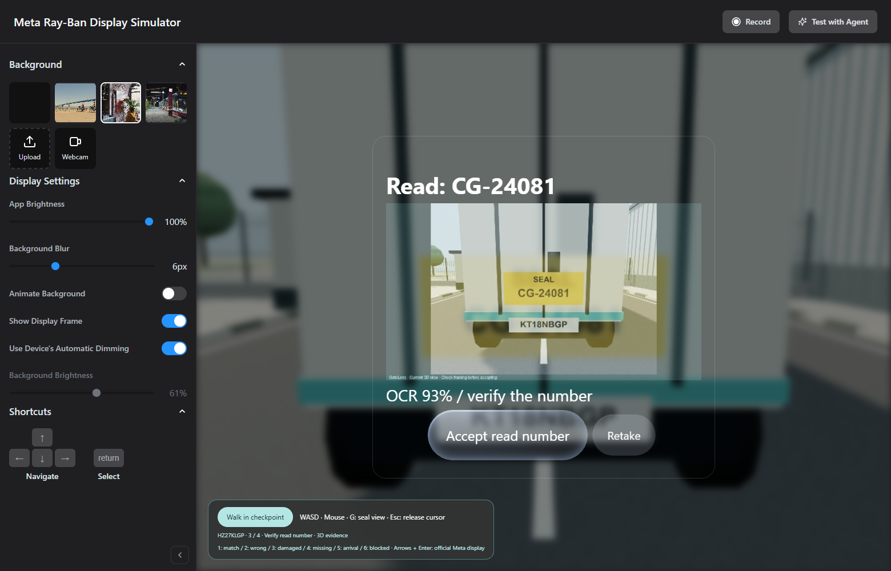
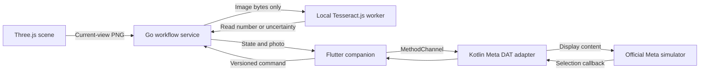

# GateLens

**A smart-glasses truck-inspection prototype built with Flutter, Kotlin, Go and local photo OCR.**

Confirm a trailer, photograph its seal label, review the number read from the image, and save an inspection or create an incident with evidence. Six fictional jobs exercise matching, mismatching, unreadable, missing-label, arrival and blocked cases.



**Experimental, simulator-tested.** The display uses Meta's official SDK and simulator. Photos come from our 3D scene; OCR reads those pixels. The detector supports the scene's known yellow `SEAL` label, not arbitrary physical seals or tamper detection. No physical glasses, production backend or real gate have been validated or connected.

## Try the workflow

1. Load a truck assignment. In the Meta view, wait for the truck to arrive and select **Check for truck**. In the standalone scene, enter the checkpoint and look at the truck.
2. Select **Start inspection → Trailer confirmed**.
3. Walk to the rear or press **G** to position your view at the seal. Select **Capture and read seal**.
4. Inspect the photograph and OCR number. **Accept read number** continues; **Retake** captures a new view.
5. Save a matching inspection or arrival registration. A mismatch offers **Create incident**. An unreadable image offers retake or manual review.

For a negative case, press **R** before capture: the cab photograph must not acquire the expected seal number. Press **G** and retake to read the label. Inspection actions leave the barrier closed. Records are in memory and disappear on scenario reset or restart.

| Key | Job | Outcome |
| --- | --- | --- |
| 1 | Matching dispatch | Save inspection |
| 2 | Different seal | Create mismatch incident |
| 3 | Damaged label | Retake or report for manual review |
| 4 | No label | Retake or report for manual review |
| 5 | Arrival, no reference number | Register the observed number |
| 6 | Blocked assignment | Inspection unavailable |

## Start locally

Clone the public source repository:

```powershell
git clone https://github.com/CreVL/gate-lens-ai-meta.git
cd gate-lens-ai-meta
```

Windows PowerShell launchers are provided. Use an ASCII-only checkout path, for example `C:\Projects\gatelens`. First setup needs network access for dependencies. Subsequent OCR runs use a local model.

### Standalone 3D scene

Requires **Go 1.24+**, **Node.js 20+**, **pnpm 11** on PATH and a WebGL 2 browser. No Android emulator or Meta extension is needed for this mode.

```powershell
.\scripts\start-walkthrough.ps1
```

Open `http://127.0.0.1:9010` yourself. This mode uses GateLens's HTML display. `-Port 9011` selects another local port. Ctrl+C stops the foreground server.

### Official Meta display + Flutter companion

Also requires Flutter **3.38.1** / Dart **3.10** (see `.fvmrc`), Android SDK **36**, JDK **17+**, an Android emulator running API **31+**, and the [Meta Ray-Ban Display Simulator extension](https://chromewebstore.google.com/detail/meta-ray-ban-display-simu/jpjlmmodokemlepklkdbimceggpbjcll). Tested with Android Studio JDK 21 and an API 36 emulator. Install Android components and accept applicable SDK licenses through your normal setup first.

```powershell
.\scripts\start-meta-walkthrough.ps1 -Device emulator-5554
```

The launcher builds and starts the companion and local service and configures ADB. Without `-Device`, it uses the only running emulator or starts the named/default AVD (`-Avd YourAvdName`). It never opens browser windows.

Open `http://127.0.0.1:9010/glasses` yourself and enable the Meta extension for this origin. Keep the companion active. If needed, select **Start Meta preview** in the Android app. After replacing the APK, refresh the browser page.

WASD + mouse move/look; Shift moves faster; **G** goes to the seal; **R** returns to the front; **Esc** releases the pointer. Use visible display buttons or arrows + Enter. Set background blur to zero in the Meta sidebar if preferred.

See [setup and troubleshooting](docs/setup.md).

## Architecture



The recognizer never receives the expected seal, job ID or scene metadata. Comparison happens afterwards in Go. Capture IDs and state versions prevent old photos and late OCR from affecting a new inspection. Operator review remains explicit.

The walkable background around the official display is a custom GateLens composition adapter, not an official Meta 3D API. SDK and extension files are served from installed dependencies, not copied into this repository.

## Repository

| Directory | Responsibility |
| --- | --- |
| `apps/companion` | Dart workflow presentation and Kotlin DAT integration |
| `apps/simulator` | 3D scene, current-view photos, local OCR and browser tests |
| `services/access-demo` | State machine, evidence, comparison and incidents |
| `scripts` | Local Windows launchers |
| `docs` | Data contract, recognition boundaries and verification |

## Verification

See [verification](docs/verification.md) for the tested environment, commands and limitations. Unit tests use injected recognizers; pixel tests and browser flows use real local OCR. A simulator result is not physical-device validation.

## Data and limits

- Fixtures use invented people, companies, identifiers, plates and seal numbers. Field names, nesting and types preserve the supported source-contract subset. [Data contract](docs/data-contract.md).
- Only one supported label per image; no physical authenticity, wire integrity or general object-recognition claim. [Recognition details](docs/recognition.md).
- Single local session, in-memory storage, no authentication for deployment, production writes, notifications or supervisor approval UI.
- Vehicle assignment detection is simulated. A readable seal does not authorize release. The inspection UI does not open the gate.
- This is an independent technical prototype, not an endorsed Meta product or an employer deployment. No measured productivity benefit is claimed.

GateLens-authored code is available under [MIT](LICENSE). Dependencies retain their own licenses and terms; see [third-party notices](THIRD_PARTY_NOTICES.md).
