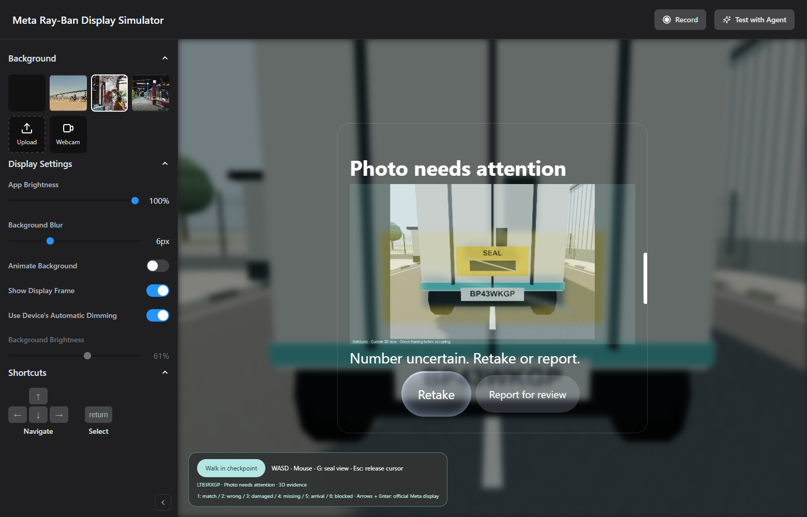
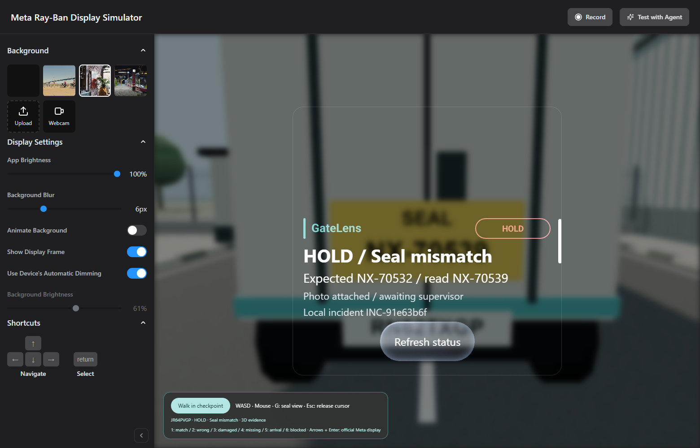

# Recognition and evidence boundaries

The browser captures the current 3D camera view as a 1280×720 PNG, letterboxed with a separate caption. Capture does not reposition the camera, substitute a rear view or stamp the expected number. G is an explicit user action that moves the viewpoint before capture. Webcam backgrounds and physical-glasses cameras are not capture sources in this version.

Go bounds and fully decodes the PNG, stores it and launches a local Node process. The input contains only the image bytes. The process finds yellow label-shaped regions, prepares crops and runs Tesseract.js using the installed English model. A readable result requires `SEAL`, a single `AA-12345` number and an OCR score of at least 70. The service validates the image digest and result before comparing with the assignment.

This detector supports one known design. A printed imitation with the same label could pass. It does not establish physical seal authenticity, wire integrity, tampering or general seal recognition. A negative result means the image did not establish a supported readable label; it does not prove the seal is physically absent. OCR scores are not calibrated probabilities. The operator must review the photo and number.

```text
ready → trailer → seal → photo_pending → analyzing → photo_review
readable:      → review → complete | incident
not readable: → issue_review → incident
```

- Retake clears the previous photo, read number and comparison.
- Capture IDs, scenario revisions and inspection versions reject stale uploads and callbacks.
- Retake/reset cancels OCR; late results are checked against the current photo and job.
- Recognition runs asynchronously with a 45-second timeout. An unavailable worker returns uncertainty, never a fallback number.
- An unreadable photo cannot be accepted as a successful inspection. It can be attached to a manual-review incident.
- No inspection action opens a gate. The legacy virtual-opening API has separate confirmation and matching-inspection checks; arrival registration does not satisfy them.

Next validation would require representative real photographs, actual camera integration and a controlled phone-versus-glasses field trial. No throughput, accuracy or cost-saving claims are established by the current simulator.




